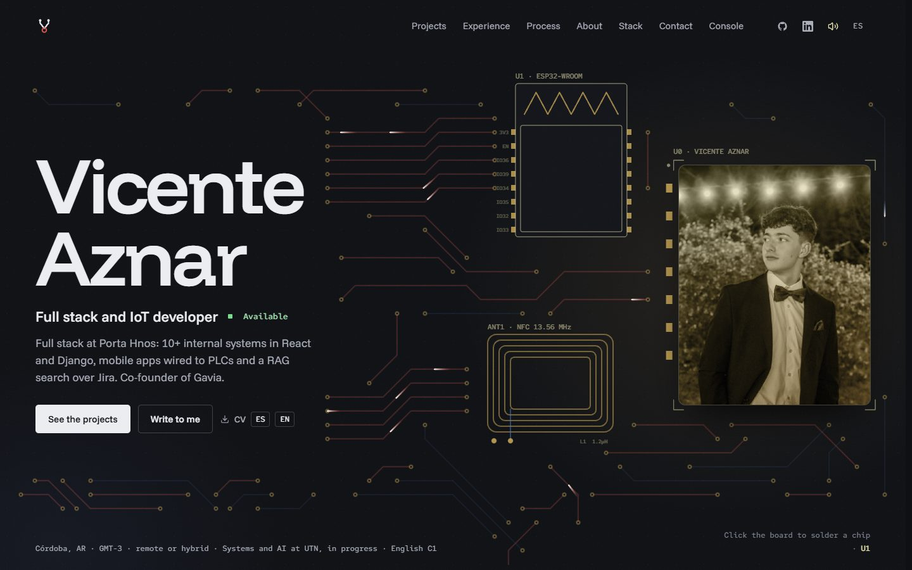
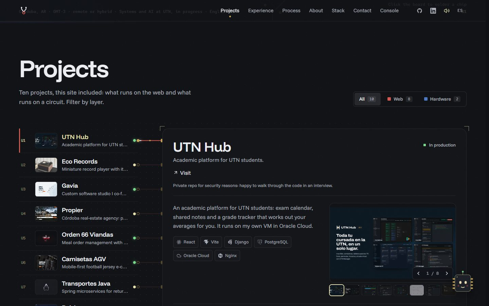
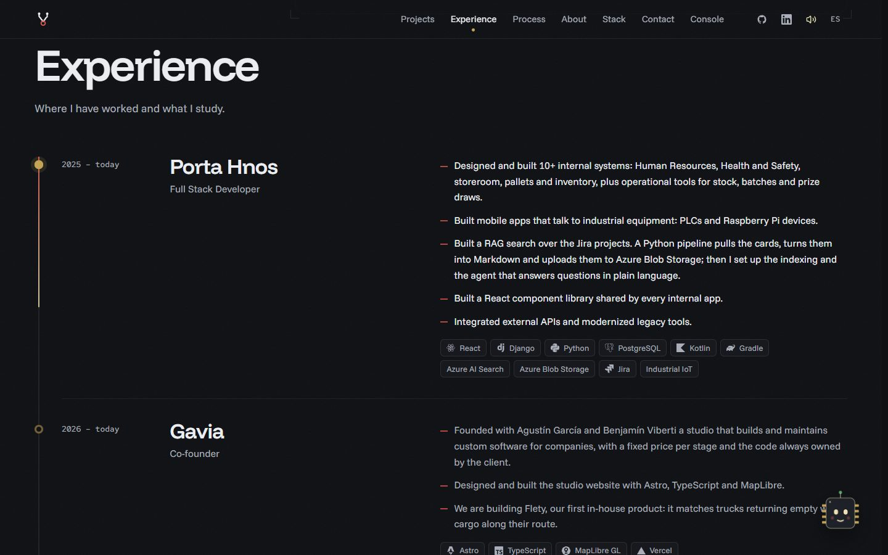
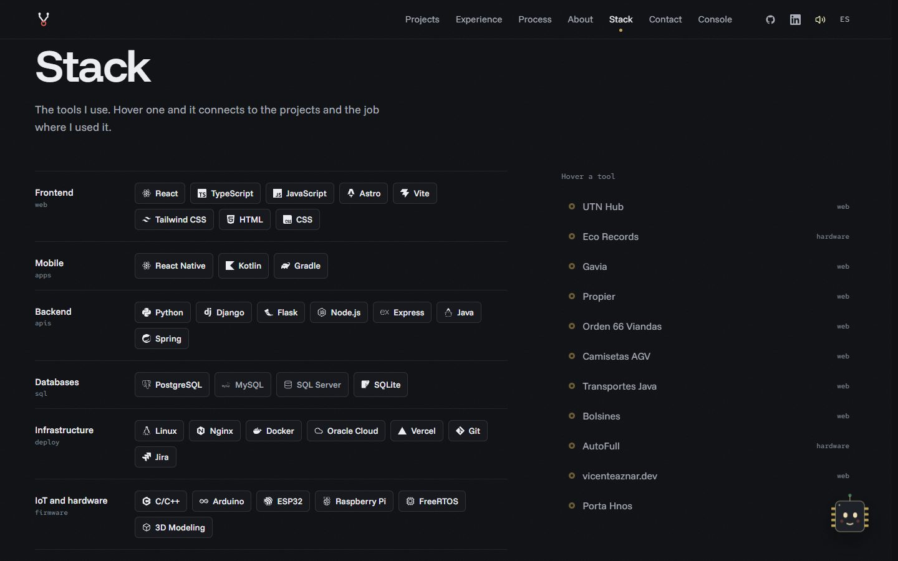
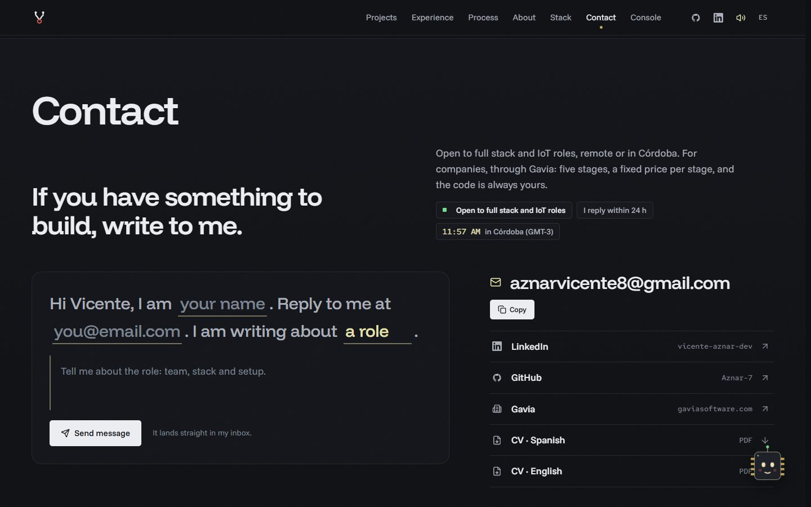
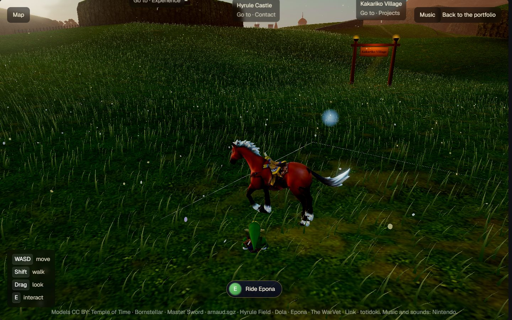
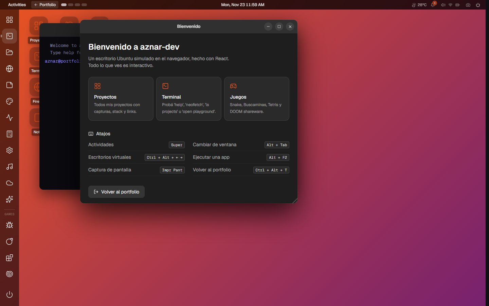
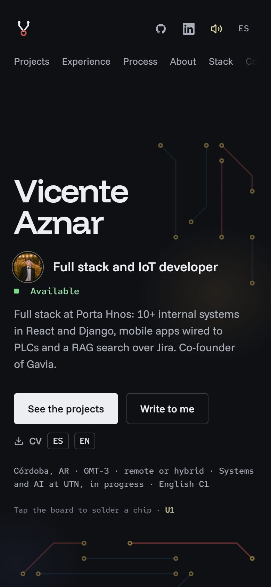

<div align="center">

# Vicente Aznar · Portfolio

**Full stack and IoT developer in Córdoba, Argentina.**
React and Django systems in production on my own Linux servers, and hardware built with ESP32 and Raspberry Pi.

[**vicenteaznar.dev**](https://www.vicenteaznar.dev) · [English](https://www.vicenteaznar.dev/en/) · [LinkedIn](https://www.linkedin.com/in/vicente-aznar-dev) · [GitHub](https://github.com/Aznar-7)



</div>

The site is one printed circuit board. The hero routes its own traces around the copy when the page loads, and each part on it (the ESP32, the NFC antenna, the portrait) links to the work it stands for. Further down, projects sit on layers you can filter, the stack is a ratsnest wired to the projects that prove each tool, and the console at the bottom powers the page down into an Ubuntu desktop.

Everything on it can be read in the first ten seconds. The fun is layered on top: ten secrets, three of them full 3D worlds.

## What's on the board

<table>
  <tr>
    <td width="50%"></td>
    <td width="50%"></td>
  </tr>
  <tr>
    <td><b>Projects.</b> Ten projects across web and hardware. The inspector shows each one in full: what it does, how it is built, screenshots, live link and code. UTN Hub has a live request-flow diagram of its own architecture.</td>
    <td><b>Experience.</b> Full Stack at Porta Hnos (10+ internal systems, apps that talk to PLCs, a RAG search over Jira), co-founder of Gavia, and Systems Engineering and AI at UTN, in progress.</td>
  </tr>
  <tr>
    <td></td>
    <td></td>
  </tr>
  <tr>
    <td><b>Stack.</b> Hover a tool and it wires itself to the projects and the job where it was used. A tool with no public proof says so.</td>
    <td><b>Contact.</b> A form that reads as a letter you fill in, sent from the page. Email, LinkedIn, GitHub, Gavia and the CV in Spanish and English.</td>
  </tr>
</table>

## Easter eggs

<table>
  <tr>
    <td width="62%"></td>
    <td width="38%"></td>
  </tr>
  <tr>
    <td><b>Hyrule.</b> Play the Song of Time and the Temple of Time opens. Draw the Master Sword and Hyrule Field waits at dusk. Walk or ride Epona to five places, each one a section of the portfolio: Kakariko hangs the projects as banners, Death Mountain carves the stack in stone. See all five and Navi hands you the letter.</td>
    <td><b>Ubuntu.</b> The console powers the page down into a desktop: windows, dock, terminal, files, music, weather, paint, and Snake, Minesweeper, Tetris and DOOM.</td>
  </tr>
</table>

There are ten secrets in total. The console at the bottom of the page lists hints with `cat .secrets`. If you'd rather be told:

<details>
<summary>All ten, spoiled</summary>

| Secret | How |
| --- | --- |
| Board complete | Click all six chips on the board, at the very top. |
| The Doors of Durin | In the console, type `mellon`. |
| sudo hire | In the console, type `sudo hire`. |
| Order 66 | In the console, type `execute order 66`. |
| Jump to hyperspace | Anywhere: ↑ ↑ ↓ ↓ ← → ← → B A. |
| 88 miles per hour | Click "Back to the past" in the console. |
| Reading the source | Open the browser console and type `hire()`. |
| A mate | Leave the page alone for a minute. |
| The Ocarina of Time | Find three secrets and Navi calls you. Follow her. |
| Seven years later | With the ocarina, play the Song of Time: → A ↓ → A ↓. |

</details>

## Phone



The board is laid out again for small screens, not scaled down. The sections stack, the nav scrolls in its own row, and touch targets are at least 40 px. Hyrule gets an on-screen stick and an action button.

Reduced motion is honored throughout: the board draws itself already routed, and the eggs keep their state changes (Order 66 still turns the board red) without the animation.

<br clear="right" />

## Under the hood

| | |
| --- | --- |
| **App** | React 19 with the React Compiler, Vite 8, plain CSS for the board, Tailwind 4 and Motion for the Ubuntu simulator |
| **Hero board** | `src/components/board/engine.js`: a canvas autorouter outside React. It routes traces around the copy, grows buses from the parts and reacts to the cursor |
| **3D** | three.js for Hyrule, the ocarina, Order 66, the DeLorean and the galaxy. Models are meshopt-compressed with WebP textures (Hyrule went from 19.3 MB to 6.5 MB), and each egg frees its scenes and WebGL context on exit |
| **Motion** | GSAP ScrollTrigger for the sections, every effect with a reduced-motion branch |
| **Content** | One source of truth in `src/data` and `src/i18n`, Spanish and English |
| **SEO** | A Vite plugin in `vite.config.js` writes the whole page as plain HTML at build time from the same data, so crawlers that run no JavaScript read real content. It also builds `/en/` with English meta, plus the JSON-LD graph (Person, Gavia, ProfilePage and every project) |
| **Loading** | The page is about 220 KB of gzipped JS. Every egg is a lazy chunk, and the service worker precaches only the page (0.8 MB), not the eggs |
| **Hosting** | Vercel, with `vercel.json` setting immutable caching for hashed assets and baseline security headers |

## Run it

```bash
npm install
npm run dev        # http://localhost:5173
npm run build      # dist/, plus dist/en/
npm run preview
npm run lint
npm run cv         # rebuilds both CV PDFs from src/data (uses the installed Edge or Chrome)
```

The contact form sends through [Web3Forms](https://web3forms.com). Copy `.env.example` to `.env` and set `VITE_WEB3FORMS_KEY`. In production, set the same variable in Vercel.

## Editing the content

| What | Where |
| --- | --- |
| Name, email, links, CVs | `src/data/site.js` |
| Bio and quick facts | `src/data/about.js` |
| Projects (summary, stack, screenshots, links, notes) | `src/data/projects.js` |
| Jobs and education | `src/data/experience.js` |
| Tools and the projects that prove them | `src/data/skills.js` |
| Every piece of interface copy, both languages | `src/i18n/site.js` |

The plain-HTML page, `/en/` and the JSON-LD are built from these files, so they never fall behind the site.

```text
src/
  components/
    board/       the page: Hero, Work, Path, Process, About, Shop, Contact, the eggs on the board
    retro/       full-screen eggs: Hyrule, Middle-earth, Galaxy, Windows 95
    layout/      the Ubuntu simulator
  data/          content
  i18n/          interface copy
  lib/           secrets, motion, ocarina, power
  styles/        board.css and one stylesheet per egg
public/
  models/        glTF models (meshopt + WebP)
  audio/         music and sounds for the eggs
  images/        project screenshots
```

## Credits

3D models, CC BY via Sketchfab: Temple of Time by Bornstellar Makes Eternallasting, Master Sword by arnaud.sgz, Hyrule Field by Dola, Epona by The WarVet, Link by totidoki, Ocarina of Time by marvelmaster. The Legend of Zelda music and sounds belong to Nintendo, and the other eggs' music to their owners; they appear here as non-commercial homage.

## License

The code is mine and is here to read. The content (copy, photos, project screenshots and the CVs) is personal and not for reuse.

---

<div align="center">
Built in Córdoba by Vicente Aznar. Looking for a full stack developer? <a href="mailto:aznarvicente8@gmail.com">Write to me</a>.
</div>
